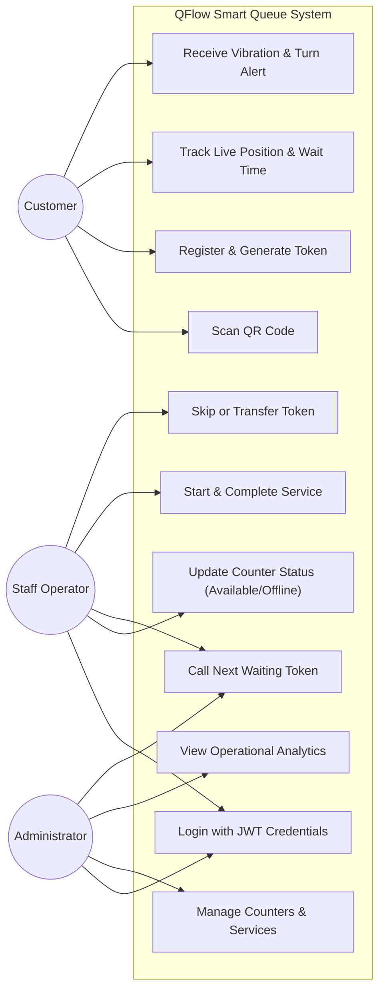
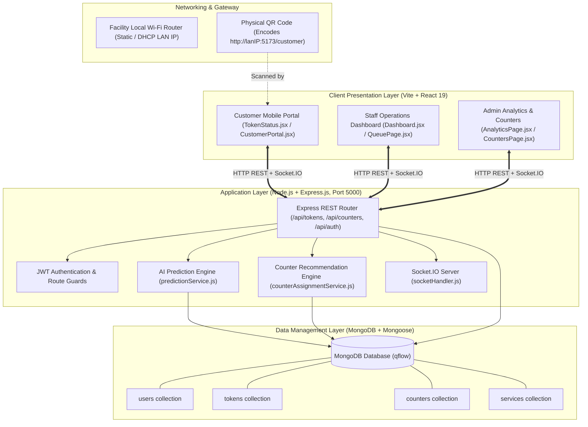
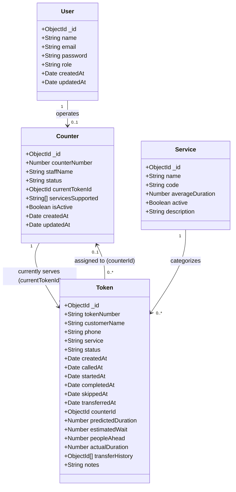
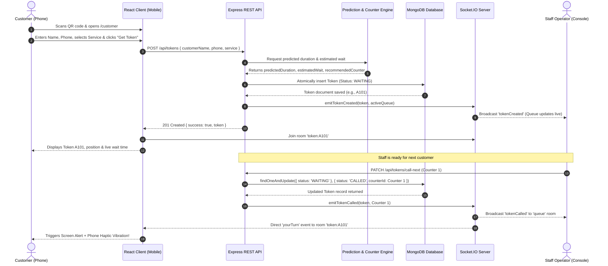

# QFLOW: AI-POWERED SMART TOKEN AND QUEUE MANAGEMENT SYSTEM FOR DYNAMIC COUNTER ASSIGNMENT AND REAL-TIME OPERATIONS

### A PROJECT REPORT
Submitted by  
**ADITHYA P K** (Registration No: **310624243009**)  
*(Placeholder for additional team members if applicable: `[STUDENT_NAME_2 (Reg No: XXXXXXXXXXXX)]`)*  

in partial fulfillment for the award of the Degree  
of  
**BACHELOR OF TECHNOLOGY**  
in  
**DEPARTMENT OF ARTIFICIAL INTELLIGENCE AND DATA SCIENCE**  

---

**EASWARI ENGINEERING COLLEGE**  
*(AN AUTONOMOUS INSTITUTION)*  
AFFILIATED TO ANNA UNIVERSITY, CHENNAI  
**OCTOBER 2026**  

---

## EASWARI ENGINEERING COLLEGE
### BONAFIDE CERTIFICATE

Certified that this project report titled **“QFLOW: AI-POWERED SMART TOKEN AND QUEUE MANAGEMENT SYSTEM FOR DYNAMIC COUNTER ASSIGNMENT AND REAL-TIME OPERATIONS”** is the Bonafide work of **“ADITHYA P K (310624243009)”**, who carried out the project work under my supervision.

| HEAD OF THE DEPARTMENT | SUPERVISOR |
| :--- | :--- |
| **Dr. T. Kalai Selvi**<br>Professor & Head<br>Department of AI & DS<br>Easwari Engineering College,<br>Ramapuram, Chennai – 600089. | **Ms. D. S. K. Harshitha**<br>Assistant Professor<br>Department of AI & DS<br>Easwari Engineering College,<br>Ramapuram, Chennai – 600089. |

---

## EASWARI ENGINEERING COLLEGE
### Certificate Of Viva-Voce Examination

This is to certify that the Viva-Voce Examination of the Project Work entitled **“QFLOW: AI-POWERED SMART TOKEN AND QUEUE MANAGEMENT SYSTEM FOR DYNAMIC COUNTER ASSIGNMENT AND REAL-TIME OPERATIONS”** submitted by **Mr. Adithya P K (Reg. No. 310624243009)** in partial fulfillment of the requirements for the award of the degree of Bachelor of Technology was conducted on **23-10-2026** in the Department of Artificial Intelligence and Data Science, Easwari Engineering College, Ramapuram – Chennai.

<br><br>
**Internal Examiner** &emsp;&emsp;&emsp;&emsp;&emsp;&emsp;&emsp;&emsp;&emsp;&emsp;&emsp;&emsp;&emsp;&emsp;&emsp;&emsp;&emsp; **External Examiner**  
Date: &emsp;&emsp;&emsp;&emsp;&emsp;&emsp;&emsp;&emsp;&emsp;&emsp;&emsp;&emsp;&emsp;&emsp;&emsp;&emsp;&emsp;&emsp;&emsp;&emsp;&emsp; Date:

---

## ABSTRACT

Queueing environments in service facilities such as banks, outpatient clinics, customer care centers, and administrative offices regularly suffer from severe customer congestion, unpredictable waiting durations, and inefficient teller resource utilization. Conventional queue management solutions rely on thermal paper token dispensers, fixed static display monitors, and inflexible First-Come-First-Served (FCFS) counter assignments. These legacy approaches leave customers tethered to crowded waiting lounges with zero real-time visibility into their turn progression, while preventing supervisors from dynamically balancing workloads across available service desks.

To address these systemic bottlenecks, this project presents **QFlow**, an AI-powered, full-stack, real-time smart token and queue management system designed for responsive customer self-service and dynamic counter orchestration. Developed on the MERN stack (MongoDB, Express.js, React 19, Node.js) with native Socket.IO bi-directional WebSocket communication, QFlow replaces physical hardware kiosks with an accessible browser-based mobile portal. Customers join the virtual queue on their personal mobile devices by scanning a physical QR code encoding the local gateway IP address, requiring no mobile app installation or account registration. 

Upon token issuance, a lightweight multi-factor predictive engine estimates the customer's anticipated service duration and queue waiting time using a calibrated synthetic historical baseline adjusted dynamically for service complexity, time-of-day peak multipliers, and active queue length. Simultaneously, an automated heuristic counter recommendation algorithm scores and assigns incoming customers to optimal service counters based on live counter occupancy, pending workload, and estimated time-to-completion. Staff operators manage the queue via a dedicated control console that supports calling next, starting service, completing consultations, marking unserved customers as skipped, and transferring tokens across departments. Real-time token lifecycle events trigger instant browser push notifications and haptic device vibration alerts on the customer's mobile device when their token is called. 

Comprehensive functional and concurrency testing demonstrates that the end-to-end architecture executes atomic database transitions, isolates customer subscriptions into dedicated socket channels, prevents race conditions during simultaneous counter calls, and maintains sub-millisecond real-time event dissemination across heterogeneous client platforms.

**Keywords:** Smart Queue Management, Artificial Intelligence, Real-Time Synchronization, Socket.IO, MERN Stack, React 19, Dynamic Counter Allocation, Wait-Time Prediction.

---

## ACKNOWLEDGEMENT

We express our sincere gratitude to our respected Principal **Dr. P. Deiva Sundari** and the Management of Easwari Engineering College for providing us with the necessary computing infrastructure, institutional environment, and facilities to carry out this project work successfully.

We convey our heartfelt thanks to our Head of the Department, **Dr. T. Kalai Selvi**, Department of Artificial Intelligence and Data Science, for her continuous academic encouragement, constructive suggestions, and steady administrative support throughout the development phases.

We are profoundly thankful and indebted to our Project Supervisor, **Ms. D. S. K. Harshitha**, Assistant Professor, Department of Artificial Intelligence and Data Science, for her invaluable guidance, rigorous technical feedback, patient mentoring, and inspiring motivation during every stage of this project.

We also wish to extend our gratitude to all the teaching faculty members, technical laboratory assistants, and staff members of the Department of Artificial Intelligence and Data Science for their direct and indirect assistance.

Finally, we express our warmest thanks to our parents, family members, and friends for their constant understanding, moral encouragement, and unconditional support during the course of this academic endeavour.

---

## TABLE OF CONTENTS

| CHAPTER NO. | TITLE | PAGE No. |
| :---: | :--- | :---: |
| | **ABSTRACT** | **iv** |
| | **ACKNOWLEDGEMENT** | **v** |
| | **LIST OF TABLES** | **viii** |
| | **LIST OF FIGURES** | **ix** |
| **1** | **INTRODUCTION** | **1** |
| | 1.1 OVERVIEW | 1 |
| | 1.1.1 Need for a Centralized Queue and Token Management System | 1 |
| | 1.1.2 Limitations of Existing Manual and Physical Token Systems | 2 |
| | 1.2 OBJECTIVE | 2 |
| | 1.3 SCOPE OF THE PROJECT | 3 |
| | 1.4 MOTIVATION | 4 |
| | 1.5 ORGANIZATION OF THE REPORT | 4 |
| **2** | **RELATED WORK** | **6** |
| | 2.1 LITERATURE REVIEW | 6 |
| | 2.2 EXISTING SYSTEMS | 7 |
| | 2.3 INFERENCE FROM LITERATURE REVIEW | 8 |
| | 2.4 EXTRACTION FROM LITERATURE REVIEW | 9 |
| **3** | **SYSTEM ANALYSIS** | **10** |
| | 3.1 PROBLEM DEFINITION | 10 |
| | 3.2 PROPOSED SOLUTION | 10 |
| | 3.2.1 Functional Requirements | 11 |
| | 3.2.2 Non-Functional Requirements | 12 |
| | 3.3 SOFTWARE COMPONENTS | 12 |
| | 3.4 HARDWARE COMPONENTS | 13 |
| | 3.5 USE CASES | 13 |
| **4** | **IMPLEMENTATION** | **15** |
| | 4.1 SYSTEM ARCHITECTURE AND EXPERIMENTAL SETUP | 15 |
| | 4.2 MODULE IMPLEMENTATION DETAILS | 17 |
| | 4.2.1 Data Source Module | 18 |
| | 4.2.2 Steps of Algorithm | 18 |
| | 4.2.3 Data Processing Module | 20 |
| | 4.2.4 Explainability Module | 21 |
| | 4.2.5 Visualization and Dashboard Module | 22 |
| | 4.3 CLASS DIAGRAM | 23 |
| | 4.4 SEQUENCE DIAGRAM | 24 |
| | 4.5 TESTING AND RESULTS | 25 |
| **5** | **CONCLUSION AND FUTURE ENHANCEMENTS** | **28** |
| | 5.1 CONCLUSION | 28 |
| | 5.2 FUTURE ENHANCEMENTS | 28 |
| | **APPENDIX 1: SAMPLE CODE** | **30** |
| | 1. Project Structure | 30 |
| | 2. Installation and Run Commands | 30 |
| | 3. Environment Variables | 31 |
| | 4. Database Models and Connection | 31 |
| | 5. Main Server File | 32 |
| | 6. Token Creation & QR Generation API | 33 |
| | 7. Authentication API & Middleware | 34 |
| | 8. AI Prediction Engine & Duration Calculation | 35 |
| | 9. Dynamic Counter Recommendation Service | 36 |
| | 10. Socket.IO Real-Time Event Handlers | 37 |
| | 11. Client Real-Time Queue Context & Synchronization | 38 |
| | 12. REST API Request and Response Examples | 39 |
| | **PROJECT SCREENSHOTS** | **41** |
| | **REFERENCES** | **46** |

---

## LIST OF TABLES

| TABLE NO. | TABLE TITLE | PAGE No. |
| :---: | :--- | :---: |
| 2.1 | Comparison of Existing Approaches to Queue and Token Management | 8 |
| 2.2 | Design Principles Extracted from Literature and Their Use in QFlow | 9 |
| 3.1 | Functional Requirements of QFlow | 11 |
| 3.2 | Software Components of QFlow | 12 |
| 3.3 | Hardware Components for Development and Deployment | 13 |
| 3.4 | Description of Main Use Cases | 14 |
| 4.1 | REST API Endpoints of QFlow | 16 |
| 4.2 | Experimental Setup Used for Building and Testing | 17 |
| 4.3 | Summary of QFlow Modules | 17 |
| 4.4 | Service Catalog and Base Parameters Accepted by the Data Source Module | 18 |
| 4.5 | MongoDB Collections Used by QFlow | 24 |
| 4.6 | Functional Test Cases and Results | 25 |
| 4.7 | Technical Observations and Edge Cases Observed During Testing | 27 |

---

## LIST OF FIGURES

| FIGURE NO. | FIGURE TITLE | PAGE No. |
| :---: | :--- | :---: |
| 3.1 | Use Case Diagram of QFlow | 14 |
| 4.1 | System Architecture of QFlow | 16 |
| 4.2 | Data Flow of Token Creation, AI Estimation, and Event Emission | 19 |
| 4.3 | Class Diagram / Entity-Relationship Schema of the QFlow Data Model | 24 |
| 4.4 | Sequence Diagram for Customer Token Creation and Counter Calling | 25 |
| A.1 | Staff and Administrative Authentication Portal | 41 |
| A.2 | Live Staff Operations Dashboard with Active Counters | 41 |
| A.3 | Customer QR Code Registration Poster and Mobile Entry | 42 |
| A.4 | Mobile Customer Portal - Service Selection and Token Generation | 42 |
| A.5 | Live Customer Token Status Screen with AI Estimated Wait Time | 43 |
| A.6 | Haptic & Visual "Your Turn" Real-Time Alert Screen | 43 |
| A.7 | Counter Management and Dynamic Counter Allocation Workspace | 44 |
| A.8 | Real-Time Queue Inspection and Token Transfer Modal | 44 |
| A.9 | Executive Analytics Dashboard with Hourly Traffic and Wait-Time Trends | 45 |
| A.10 | Service Configuration and Historical Seed Audit Portal | 45 |

---

# CHAPTER 1  
# INTRODUCTION

This chapter introduces the **QFlow** Smart Token and Queue Management System. It presents the operational background of queue management across modern service institutions, explains the critical need for a centralized real-time coordination platform, reviews the inherent drawbacks of physical thermal-token and manual sign-in procedures, and details the core objectives, scope, and engineering motivation behind the project. The chapter concludes with a roadmap of the report structure.

## 1.1 OVERVIEW

In public-facing service sectors—such as banking branches, hospital diagnostic hubs, municipal licensing bureaus, logistics fulfillment desks, and academic administration centers—effective crowd coordination is pivotal to operational efficiency and customer satisfaction. Every service transaction involves a sequence of dependent events: customer arrival, identity registration, intent triage, waiting room aggregation, teller assignment, document consultation, and final completion. When these operational touchpoints are managed using disconnected paper tickets, manual clipboard rosters, or rigid standalone hardware consoles, facilities quickly experience severe physical congestion, high perceived customer frustration, and uneven teller workload distribution.

**QFlow** (branded as *QFlow: AI-Powered Smart Token & Queue Management System*) is a full-stack, distributed web application engineered to bridge the communication gap between waiting customers and serving staff. Built using a modern MERN stack architecture (MongoDB, Express.js, React 19, and Node.js) paired with Socket.IO real-time event streaming, QFlow eliminates proprietary kiosk hardware by enabling customers to scan a localized QR code on their personal smartphone. Customers immediately receive a secure, responsive, zero-install mobile token tracking interface showing their real-time position, expected wait time, and serving counter.

Concurrently, service personnel and administrators interact with a responsive operational dashboard that provides full visibility into the active queue across all facility counters. The backend couples an AI-driven service duration and wait-time predictive model with an automated dynamic counter recommendation engine. This engine evaluates real-time queue length, historical transaction variances, time-of-day peak multipliers, and active counter availability to balance customer traffic efficiently across available tellers.

### 1.1.1 Need for a Centralized Queue and Token Management System

Traditional waiting room operations face a major visibility problem. When a customer takes a physical printed ticket, the ticket represents a static serial number without contextual insight. The customer cannot know whether the three individuals ahead of them require a brief two-minute balance enquiry or an intricate twenty-minute loan document verification. Consequently, customers are forced to remain physically confined within noisy, high-density waiting lobbies, continuously craning their necks toward overhead display monitors to avoid missing their turn.

Simultaneously, facility managers lack a consolidated view of operational velocity. A branch supervisor cannot readily detect if Counter 3 is bottlenecked by complex transactions while Counter 1 remains idle, nor can they accurately measure average customer waiting times across specific hours of the day without manually collecting paper logs. 

A centralized, cloud-ready queue management system solves these issues by unifying all token lifecycles inside an atomic document database and exposing state updates across WebSocket channels. Service durations are mathematically modelled and communicated to customers in real time, granting them the freedom to wait comfortably nearby while keeping staff informed of service bottlenecks as they unfold.

### 1.1.2 Limitations of Existing Manual and Fragmented Systems

Conventional approaches to customer queue coordination suffer from distinct functional limitations:
* **Zero Waiting Time Visibility:** Static paper tokens offer no indication of expected duration or queue velocity, causing anxiety and customer dissatisfaction.
* **Physical Waiting Confinement:** Customers must stay within line-of-sight of a shared wall display or public address loudspeaker, precluding productive mobility.
* **Hardware Fragility & Waste:** Thermal ticket printers frequently jam, run out of paper rolls, and generate unnecessary consumable waste.
* **Unbalanced Workload Allocation:** Rigid FCFS queue lines fail to route customers based on teller expertise, transaction complexity, or real-time desk availability.
* **Prone to Race Conditions:** In manual systems where multiple tellers shout numbers or press mechanical counter buzzers simultaneously, customers frequently collide at the same desk.
* **Absence of Operational Analytics:** Paper slips provide no digital telemetry on hourly arrival rates, average service times, counter idle periods, or customer abandonment rates.

## 1.2 OBJECTIVE

The primary objective of QFlow is to design and develop an intelligent, real-time, browser-accessible queue management platform that replaces physical ticketing hardware with a mobile-first digital workflow. The specific objectives are:
1. To develop a responsive mobile customer portal accessible via a physical QR code without requiring native application downloads or user account registration.
2. To provide atomic sequential token generation (e.g., A101, A102) linked to specific service categories with zero collision risk under concurrent requests.
3. To engineer an AI prediction service based on synthetic historical operational data to predict transaction durations and personalized waiting times.
4. To implement a dynamic heuristic counter assignment algorithm that scores available counters and recommends optimal routing for incoming tokens.
5. To construct a staff operations dashboard providing counter status switching, next-token calling, service starting, completion recording, customer skipping, and inter-counter transferring.
6. To establish sub-millisecond, bi-directional real-time event dissemination using Socket.IO to deliver visual notifications and haptic vibration alerts directly to customer smartphones.
7. To calculate comprehensive operational analytics including hourly queue distributions, average wait times, and counter productivity metrics.
8. To containerize and package the full-stack system using a multi-service architecture for straightforward local and on-premise deployment.

## 1.3 SCOPE OF THE PROJECT

The scope of QFlow encompasses an end-to-end software platform for managing customer queues, service desk allocations, token lifecycle transitions, and real-time operational analytics.

**In Scope:**
* Dynamic QR code generation embedding the local host's Wi-Fi network gateway IPv4 address for multi-device cross-network accessibility.
* Frictionless customer self-service mobile registration capturing name, contact number, and chosen service category.
* Atomic token sequencing supporting the complete lifecycle state machine: `WAITING`, `CALLED`, `IN_SERVICE`, `COMPLETED`, `SKIPPED`, and `TRANSFERRED`.
* AI-driven duration prediction combining service-type base times, peak-hour multipliers, and queue density factors.
* Real-time push communication using Socket.IO rooms to isolate private customer updates from public administrative queue feeds.
* Browser-level haptic vibration execution via the Web Vibration API (`navigator.vibrate`) upon counter calling.
* Administrative staff management, counter creation, service catalogue configuration, and MongoDB aggregation analytics.
* Secure role-based staff authentication utilizing JSON Web Tokens (JWT) and bcrypt password encryption.

**Out of Scope:**
* Direct integration with legacy physical thermal receipt printers or RS-485 seven-segment counter display hardware.
* Native SMS telecommunication gateway dispatch (cellular SMS), relying instead on persistent mobile WebSocket streams.
* Facial recognition or biometric customer identification.
* Multi-branch, multi-tenant global cloud orchestration (the current system is architected for single-facility local area deployment).

## 1.4 MOTIVATION

Queueing environments are ubiquitous across society. Long, disorganized physical lines reduce economic productivity and elevate customer stress levels. The widespread adoption of smartphones with integrated camera modules presents an ideal opportunity to transform queueing into a frictionless digital interaction. By enabling a customer to scan a QR code and immediately receive a live-updating, vibrating token on their phone, the physical waiting lounge is virtualized.

As an academic project in Artificial Intelligence and Data Science, QFlow provides practical exposure to full-stack engineering challenges: asynchronous client-server event architectures, real-time WebSocket state synchronization, atomic document database locking under concurrency, and mathematical modeling of service queue dynamics. The resulting system demonstrates how standard web technologies can eliminate expensive industrial kiosk hardware while improving customer experience.

## 1.5 ORGANIZATION OF THE REPORT

The remainder of this report is organized as follows:
* **Chapter 2 - Related Work** reviews foundational queueing theory, real-time distributed web communication protocols, state-of-the-art queue architectures, and derives the design principles governing QFlow.
* **Chapter 3 - System Analysis** formalizes the problem definition, details functional and non-functional requirements, itemizes software and hardware dependencies, and outlines primary user use cases.
* **Chapter 4 - Implementation** explains system architecture, experimental test setups, core algorithmic formulations for AI duration and counter recommendation, Mongoose database schemas, sequence diagrams, and empirical test results.
* **Chapter 5 - Conclusion and Future Enhancements** summarizes key project achievements, identifies current operational boundaries, and proposes directions for subsequent development.
* **Appendix 1** provides representative source code excerpts, followed by Project Screenshots and References.

---

# CHAPTER 2  
# RELATED WORK

This chapter reviews theoretical literature, algorithmic models, and existing technological frameworks relevant to queue management, service operations scheduling, and real-time distributed web applications. It surveys classical queueing models, examines conventional physical and commercial queue architectures, highlights key inferences from prior research, and details the specific design principles adopted in QFlow.

## 2.1 LITERATURE REVIEW

**Queueing Theory and Operational Dynamics.** Queueing theory, initiated by A. K. Erlang's pioneering mathematical formulations for telephone traffic congestion [1], provides the quantitative foundation for evaluating waiting lines. Kendall's notation classifies queueing systems based on arrival patterns, service time distributions, and the number of servers (e.g., $M/M/1$, $M/M/c$) [2]. Little's Law ($\bar{L} = \lambda \bar{W}$) mathematically establishes that the average number of customers in a stationary queueing system ($\bar{L}$) equals the long-term average arrival rate ($\lambda$) multiplied by the average time a customer spends in the system ($\bar{W}$) [3]. 

While classical analytical models assume idealized Poisson arrival processes and exponential service distributions, real-world service facilities experience dynamic variance driven by human behavioral factors and transaction complexity. QFlow adopts these theoretical principles by dynamically computing estimated wait time as the aggregated pending workload divided by active counter capacity.

**Predictive Scheduling in Service Operations.** Larson's seminal work on the psychology of queueing demonstrated that perceived waiting time, lack of temporal visibility, and unexplained delays exert a significantly more detrimental impact on customer satisfaction than objective elapsed time [4]. Providing customers with an accurate initial duration estimate fundamentally reduces perceived anxiety. Modern predictive frameworks increasingly apply machine-learning heuristics to forecast operational service durations using features such as transaction category, temporal peak windows, and real-time server density [5]. QFlow incorporates these insights via a lightweight weighted-regression model that calibrates base service metrics against historical peak variances.

**Real-Time Bi-Directional Web Architectures.** Traditional web applications rely on stateless HTTP request-response cycles. Under high-frequency polling architectures where clients query the server every few seconds to check queue position, server thread pools become rapidly saturated by redundant HTTP handshakes [6]. The WebSocket protocol (IETF RFC 6455) provides full-duplex, persistent communication channels over a single TCP connection, drastically minimizing overhead and latency [7]. Socket.IO abstracts WebSocket transport with automatic HTTP long-polling fallback, structured event multiplexing, and room-based channel isolation [8]. QFlow leverages Socket.IO rooms to broadcast public queue states while privately channeling status alerts to specific customer devices.

**Document-Oriented Database Concurrency.** In transactional queueing systems, concurrency control is vital. When multiple service counters attempt to call the next waiting customer simultaneously, naive read-modify-write patterns result in race conditions where two tellers are assigned the same ticket [9]. Modern document stores like MongoDB provide atomic single-document modifications via operators such as `findOneAndUpdate`, ensuring linearizable state transitions without the operational overhead of heavy multi-table SQL locks [10].

## 2.2 EXISTING SYSTEMS

Current queue management approaches deployed across public and commercial facilities can be categorized into four primary paradigms. Their operational characteristics are contrasted in Table 2.1.

1. **Physical Thermal Paper Dispensers & Buzzers:** Found in post offices, retail banks, and clinics. A mechanical dispenser prints a numbered slip, and overhead LED digit boards display the called number. Customers must remain in the physical room to watch the board. These systems consume paper, jam frequently, offer no wait-time estimation, and cannot adapt to dynamic counter conditions.
2. **Dedicated Self-Service Hardware Kiosks:** Large freestanding touchscreen terminals equipped with industrial barcode readers and receipt printers. While functional, they entail high capital acquisition costs, require ongoing hardware maintenance, and still produce physical slips without smartphone integration.
3. **Proprietary Native Mobile Applications:** Commercial enterprise solutions that require customers to download an application from an app store, register a user account, and enable GPS location permissions before joining a queue. The significant friction of installation and registration causes many casual visitors to bypass the digital queue entirely.
4. **QFlow (Proposed System):** A zero-install, browser-based web architecture. Customers scan a physical QR code using their existing phone camera, instantly joining the queue on a mobile browser. The platform incorporates AI-driven wait estimation, dynamic counter scoring, Socket.IO haptic alerts, and complete administrative queue governance on the MERN stack.

Table 2.1: Comparison of Existing Approaches to Queue and Token Management
| Approach | Physical Hardware Dependency | Mobile Smartphone Integration | Wait-Time Estimation | Real-Time Push Alerts | Installation / Friction |
| :--- | :--- | :--- | :--- | :--- | :--- |
| **Paper Thermal Dispensers** | High (Printers, Displays) | None | None | Audio chime only | Low friction, high physical confinement |
| **Enterprise Touchscreen Kiosks** | High (Costly kiosks) | Minimal (Optional SMS) | Static average | Public display screens | Moderate friction, hardware maintenance |
| **Proprietary Native Apps** | Low | High | Basic heuristic | Push notifications | Very high friction (App install + signup required) |
| **QFlow (This Project)** | Minimal (Static printed QR) | High (Zero-install web app) | Dynamic AI prediction | Socket.IO push + Phone vibration | Zero friction (Scan and go) |

## 2.3 INFERENCE FROM LITERATURE REVIEW

The review of queueing theory, service operations psychology, and real-time distributed software leads to the following key inferences:
* **Visibility Reduces Perceived Waiting Time:** Accurately calculating and displaying expected wait times alleviates customer stress and prevents queue abandonment [4].
* **Frictionless Onboarding is Critical:** Systems that mandate account creation or native application installation encounter steep adoption resistance from one-time visitors. A browser-based QR entry model minimizes barriers to entry.
* **Push-Based Updates Outperform Polling:** Continuous HTTP polling degrades mobile battery life and overburdens server resources. Persistent WebSocket connections provide instant notification with minimal network overhead [6], [7].
* **Atomic State Transitions Prevent Collisions:** Tellers operating under peak loads require guaranteed atomic database operations to eliminate double-calling race conditions [10].
* **Dynamic Counter Allocation Improves Utilization:** Static counter assignment leads to uneven queue distribution; automated scoring balances traffic according to live desk capacity.

## 2.4 EXTRACTION FROM LITERATURE REVIEW

Based on these inferences, the architectural and algorithmic design principles summarized in Table 2.2 were extracted and implemented in QFlow.

Table 2.2: Design Principles Extracted from Literature and Their Use in QFlow
| Principle (Literature Source) | Technical Implementation in QFlow |
| :--- | :--- |
| **Frictionless Mobile Access** [4] | Dynamic QR generation embedding local network IP; zero-install mobile web portal in React 19. |
| **Dynamic Wait-Time Estimation** [1], [3] | Algorithmic prediction combining service base durations, peak multipliers, and active counter counts. |
| **Sub-Millisecond Real-Time Push** [7], [8] | Socket.IO room architecture isolating global queue events (`queue`) from private customer notifications (`token:{id}`). |
| **Haptic Multisensory Notification** [4] | HTML5 Web Vibration API (`navigator.vibrate([300, 100, 300])`) triggered automatically on customer device upon token call. |
| **Atomic Concurrency Guarantee** [10] | MongoDB atomic `findOneAndUpdate` queries targeting `status: 'WAITING'` to eliminate race conditions. |
| **Dynamic Counter Allocation** [5] | 100-point heuristic scoring algorithm evaluating counter status, queue backlogs, and time-to-completion. |
| **Stateful Aggregation Analytics** [2] | Mongoose pipeline calculations deriving hourly traffic distribution, average wait times, and counter throughput. |

---

# CHAPTER 3  
# SYSTEM ANALYSIS

This chapter analyses the core operational problem addressed by QFlow and describes the proposed full-stack solution. It provides a formal breakdown of functional and non-functional requirements, itemizes software dependencies and hardware development environments, and details the primary use case interactions across customer, staff, and administrative actors.

## 3.1 PROBLEM DEFINITION

Public and commercial customer service facilities frequently suffer from systemic congestion, unpredictable wait times, and poor communication between customers and staff. The specific operational problems can be stated as follows:
1. **Lack of Customer Situational Awareness:** Customers waiting for service have no reliable estimate of how long their consultation will take or how many customers ahead have complex requirements.
2. **High Infrastructure and Maintenance Costs:** Conventional queue systems depend on specialized thermal ticket dispensers, roll paper refills, mechanical buttons, and physical seven-segment counter display hardware.
3. **Physical Confinement and Crowding:** Because token notifications are communicated solely through ceiling-mounted LED screens or overhead speakers, customers are forced to remain physically packed inside waiting rooms.
4. **Inefficient Counter Workload Balancing:** When tellers manually choose which token to call or operate under static ticket queues, workloads become unevenly distributed across staff members.
5. **Absence of Centralized Operational Telemetry:** Facility managers lack actionable, real-time insights into average service durations, hourly arrival spikes, and teller idle times.

The problem addressed by this project is to architect, implement, and validate a secure, real-time, browser-based queue management system that virtualizes token issuance via smartphone QR scanning, estimates wait times through an AI-calibrated heuristic model, balances counter assignments dynamically, and provides complete operational visibility to service personnel.

## 3.2 PROPOSED SOLUTION

The proposed solution is **QFlow**, an integrated, three-tier, real-time web application built on the MERN stack. Its architectural capabilities include:
* **Zero-Install Customer Portal:** Accessible on any smartphone browser by scanning a dynamic QR code. Customers register their name, phone number, and requested service, immediately receiving an atomic digital token (e.g., A101).
* **AI-Powered Duration & Wait Estimation:** An in-memory prediction service evaluates service complexity, current hour peak factors, and queue depth to generate personalized wait-time estimates.
* **Dynamic Counter Assignment Engine:** A heuristic algorithm evaluates active counter states and assigns incoming customers to optimal counters to prevent bottlenecking.
* **Real-Time Staff Operations Dashboard:** An administrative console allowing tellers to call the next customer, start consultations, complete services, skip absent visitors, and transfer tokens between departments.
* **Bi-Directional WebSocket Notifications:** Socket.IO pushes live queue transitions to both staff consoles and customer mobile screens, triggering visual banners and haptic phone vibrations.
* **Operational Performance Analytics:** MongoDB aggregation pipelines generate live charts tracking hourly customer volumes, counter throughput, and average wait times.

### 3.2.1 Functional Requirements

Table 3.1: Functional Requirements of QFlow
| ID | Requirement | Description |
| :---: | :--- | :--- |
| **FR-01** | **User Authentication** | Staff and administrative personnel can securely authenticate using email and password, receiving a signed JSON Web Token (JWT). |
| **FR-02** | **QR Code Generation** | The server detects the active Wi-Fi LAN IPv4 address and dynamically generates high-resolution QR codes linking directly to the mobile portal. |
| **FR-03** | **Customer Token Issuance** | Customers can submit their name, phone number, and service category via the mobile portal to obtain an atomic sequential token (e.g., A101). |
| **FR-04** | **AI Wait-Time Prediction** | The system automatically calculates predicted service duration and estimated queue waiting time upon token generation. |
| **FR-05** | **Dynamic Counter Recommendation** | The system calculates a multi-factor score (0–100) for active counters and recommends optimal routing for incoming tokens. |
| **FR-06** | **Staff Queue Management** | Staff can execute token state transitions: `Call Next`, `Start Service`, `Complete Service`, `Skip Token`, and `Transfer Token`. |
| **FR-07** | **Real-Time Event Broadcasting** | Token creations, calls, and completions are broadcast instantly across Socket.IO rooms (`queue` and `token:{id}`). |
| **FR-08** | **Haptic & Visual Customer Alerts** | When a token status transitions to `CALLED`, the customer’s phone displays an on-screen alert and triggers haptic vibration pulses. |
| **FR-09** | **Counter Administration** | Administrators can dynamically add new counters, update staff assignments, toggle counter availability, and delete inactive desks. |
| **FR-10** | **Operational Analytics & Metrics** | The system aggregates completed token records into real-time visual charts showing hourly traffic, average wait times, and counter throughput. |
| **FR-11** | **Database Seeding & Recovery** | The system includes automated database seed scripts to populate demo accounts, standard service catalogues, and historical analytics. |

### 3.2.2 Non-Functional Requirements

* **NFR-01 Real-Time Latency:** Queue state transitions must be dispatched across Socket.IO channels and rendered on client displays within 200 milliseconds of database commitment.
* **NFR-02 Concurrency & Data Integrity:** The backend must execute atomic database modifications using `findOneAndUpdate` to prevent race conditions during concurrent "Call Next" operations.
* **NFR-03 Zero-Friction Usability:** The customer interface must function seamlessly across modern mobile browsers (iOS Safari, Android Chrome) without requiring app store installation or login credentials.
* **NFR-04 Security & Password Protection:** Passwords must be hashed using bcrypt (salt rounds = 10), and all administrative endpoints must enforce JWT bearer token validation.
* **NFR-05 High Availability & Fallback:** The backend must support both configured persistent MongoDB connections and zero-config embedded `MongoMemoryServer` fallbacks for standalone demonstrations.

## 3.3 SOFTWARE COMPONENTS

Table 3.2: Software Components of QFlow
| Layer | Component | Version / Specification | Purpose in QFlow |
| :--- | :--- | :--- | :--- |
| **Runtime** | Node.js | v18.0.0 or higher (v22.x LTS tested) | Asynchronous backend JavaScript execution environment |
| **Frontend Framework** | React | ^19.0.0 | Component-based reactive user interface rendering |
| **Build Tool** | Vite | ^6.0.0 / ^8.0.0 | High-performance frontend dev server and production bundler |
| **Styling** | Tailwind CSS | ^3.4.0 / ^4.0.0 | Utility-first responsive CSS styling for mobile and desktop |
| **Web Framework** | Express.js | ^4.19.0 | RESTful API routing, middleware chaining, and HTTP server |
| **Database & ODM** | MongoDB & Mongoose | MongoDB 7.0 / Mongoose ^8.3.0 | Persistent document store for tokens, counters, users, and services |
| **Real-Time Transport** | Socket.IO | ^4.7.5 | Full-duplex WebSocket communication and room-based event dispatch |
| **Security & Auth** | jsonwebtoken & bcryptjs | JWT ^9.0.2 / bcryptjs ^2.4.3 | Stateless token-based authentication and adaptive password hashing |
| **Charts & Visualization** | Recharts & Lucide React | Recharts ^2.12.0 / Lucide ^0.360.0 | Analytical data graphs and iconography |
| **QR Code Generation** | qrcode & qrcode.react | qrcode ^1.5.3 / qrcode.react ^3.1.0 | Server-side image generation and client QR rendering |

## 3.4 HARDWARE COMPONENTS

QFlow is an entirely software-driven architecture that operates on standard commodity computing devices and customer smartphones over a standard local Wi-Fi router.

Table 3.3: Hardware Components for Development and Deployment
| Component | Development Workstation | Deployment Host (Server) | Client Devices (Staff & Customer) |
| :--- | :--- | :--- | :--- |
| **Processor** | 4-Core x86-64 / ARM64 CPU | 2 or more vCPUs (x86-64 / ARM64) | Any modern smartphone or desktop processor |
| **System Memory** | 8 GB RAM or higher | 2 GB to 4 GB RAM | 1 GB RAM (Mobile browser) |
| **Storage** | 5 GB SSD storage | 10 GB SSD persistent storage | Negligible (Web cache only) |
| **Networking** | 802.11ac/ax Wi-Fi or Gigabit LAN | Local Wi-Fi or static IP network interface | Smartphone connected to facility Wi-Fi |
| **Display** | 1920 × 1080 resolution monitor | Headless or desktop terminal | Responsive mobile viewport (375px+) |

## 3.5 USE CASES

The primary actors interacting with QFlow are:
1. **Customer:** Scans the facility QR code, selects a service, receives a live digital token, monitors queue progress, and receives call alerts.
2. **Staff Operator:** Logs into the console, sets counter operational status, calls the next customer in line, executes service transitions, and transfers tokens.
3. **Administrator:** Manages user accounts, creates and configures service counters, edits service catalogues, and reviews aggregate analytics.


*Figure 3.1: Use Case Diagram of QFlow*

Table 3.4: Description of Main Use Cases
| Use Case | Primary Actor | Trigger & Preconditions | Execution Flow & Outcome |
| :--- | :--- | :--- | :--- |
| **Join Queue** | Customer | Customer arrives at facility and scans physical QR code with phone. | Mobile browser opens; customer enters name, phone, and picks service; server generates atomic token (e.g. A101); estimated wait time and live position are displayed. |
| **Call Next Token** | Staff | Staff member at Counter $N$ clicks "Call Next" on dashboard. | Backend executes atomic update finding next `WAITING` token; sets status to `CALLED`; emits `yourTurn` event; customer phone vibrates and flashes counter instructions. |
| **Execute Service** | Staff | Customer arrives at desk; staff clicks "Start Service", then "Complete". | Status transitions to `IN_SERVICE` (`startedAt` stamped), then to `COMPLETED` (`completedAt` stamped); actual duration recorded; counter becomes `AVAILABLE`. |
| **Transfer Token** | Staff | Customer requires different specialized department assistance. | Staff selects target counter; status set to `TRANSFERRED`; token reassigned; target counter alerted; customer mobile display reflects new counter destination. |
| **Review Analytics** | Administrator | Admin navigates to `/analytics` tab on dashboard. | Server executes MongoDB aggregation pipeline; calculates average wait time, hourly traffic distribution, and counter productivity charts. |

---

# CHAPTER 4  
# IMPLEMENTATION

This chapter details the technical implementation of QFlow. It describes the overall system architecture and experimental development setup, explains each core software module and algorithmic formulation, specifies the MongoDB database schema design and class relationships, outlines sequence diagrams for primary operational flows, and presents empirical verification test results.

## 4.1 SYSTEM ARCHITECTURE AND EXPERIMENTAL SETUP

QFlow is built as a modular, three-tier client-server architecture designed for high-concurrency event broadcasting and frictionless mobile client interactions, as illustrated in Figure 4.1.


*Figure 4.1: System Architecture of QFlow*

The **Client Presentation Layer** is developed in React 19 using Vite. It consists of two responsive interfaces: a mobile-optimized customer portal and a full-featured staff operations dashboard. Communication with the backend occurs over HTTP REST calls (for data mutation and state retrieval) and persistent Socket.IO WebSocket connections (for instantaneous real-time event synchronization).

The **Application Layer** is hosted on Node.js using Express.js. It coordinates request validation, security token authentication, AI prediction calculations, and atomic database state transitions. The `socketHandler.js` module maintains active socket channels, multiplexing events across a public `queue` room (for staff monitors) and private `token:{tokenId}` rooms (for individual customer mobile sessions).

The **Data Management Layer** utilizes MongoDB accessed via Mongoose ODM schemas. The database stores four primary operational collections: `tokens`, `counters`, `services`, and `users`.

Table 4.1: REST API Endpoints of QFlow
| HTTP Method | API Endpoint | Access Level | Functional Purpose |
| :---: | :--- | :---: | :--- |
| `POST` | `/api/auth/login` | Public | Authenticates staff/admin credentials and issues JWT token |
| `GET` | `/api/auth/me` | Authenticated | Retrieves profile of currently authenticated user session |
| `POST` | `/api/tokens` | Public | Creates atomic sequential token with AI duration & wait estimates |
| `GET` | `/api/tokens/:id` | Public | Retrieves current status, position, and wait time for a single token |
| `PATCH` | `/api/tokens/:id/call` | Authenticated | Atomically transitions token to `CALLED` and alerts customer |
| `PATCH` | `/api/tokens/:id/start` | Authenticated | Transitions token to `IN_SERVICE` and stamps start timestamp |
| `PATCH` | `/api/tokens/:id/complete`| Authenticated | Completes service, logs actual duration, and frees counter |
| `PATCH` | `/api/tokens/:id/skip` | Authenticated | Marks absent customer as `SKIPPED` and updates queue order |
| `PATCH` | `/api/tokens/:id/transfer`| Authenticated | Transfers active token to another target counter |
| `GET` | `/api/counters` | Public / Auth | Retrieves all registered counters with live occupancy status |
| `POST` | `/api/counters` | Admin | Registers a new service counter into the facility fleet |
| `PATCH` | `/api/counters/:id/status`| Authenticated | Updates counter operational state (`AVAILABLE`, `OFFLINE`) |
| `GET` | `/api/services` | Public | Fetches active facility service catalogue with standard times |
| `GET` | `/api/queue/active` | Authenticated | Fetches complete snapshot of all active tokens in queue |
| `GET` | `/api/analytics/summary` | Authenticated | Generates aggregate metrics (average wait time, traffic trends) |
| `GET` | `/api/health` | Public | Returns system uptime, active LAN IP, and customer QR portal URL |

Table 4.2: Experimental Setup Used for Building and Testing
| Parameter | Development & Test Specification |
| :--- | :--- |
| **Operating System** | Windows 11 Enterprise (64-bit, Build 26100) / Ubuntu 22.04 LTS |
| **Node.js Environment** | Node.js v22.14.0 LTS / npm 10.9.4 |
| **Database Instance** | MongoDB Community Server v7.0.14 (Local) / MongoMemoryServer v9.1.8 |
| **Network Configuration** | Local IEEE 802.11ac Wi-Fi router (Subnet `192.168.1.0/24`) |
| **Client Devices Tested** | Apple iPhone 14 (iOS 17.5 / Safari), Samsung Galaxy S23 (Android 14 / Chrome), HP EliteBook (Edge) |
| **Verification Tools** | Postman v11.16 (REST Validation), Browser DevTools (Network & WebSocket inspection) |

## 4.2 MODULE IMPLEMENTATION DETAILS

QFlow is structured into modular subsystems mapped across the backend controllers, services, and frontend view components, as outlined in Table 4.3.

Table 4.3: Summary of QFlow Modules
| Module Name | Core Implementation Files | Primary Functional Responsibility |
| :--- | :--- | :--- |
| **Authentication & RBAC** | `authController.js`, `auth.js`, `LoginPage.jsx` | User login, bcrypt verification, JWT signing, role authorization |
| **Token Management** | `tokenController.js`, `Token.js`, `TokenStatus.jsx` | Atomic sequence generation, state transitions, customer tracking |
| **AI Prediction Service** | `predictionService.js` | Duration forecasting, peak hour adjustments, wait estimation |
| **Counter Recommendation** | `counterAssignmentService.js`, `CounterCard.jsx` | Dynamic 100-point heuristic counter scoring and workload balancing |
| **Real-Time Synchronization** | `socketHandler.js`, `socket.js`, `QueueContext.jsx` | Full-duplex WebSocket rooms, multi-device broadcasting, haptic events |
| **Analytics & Reporting** | `analyticsController.js`, `AnalyticsPage.jsx` | MongoDB aggregation pipelines, hourly queue trends, counter metrics |
| **Network & QR Generation** | `lanIP.js`, `generateQR.js`, `QRModal.jsx` | Local network IP detection, dynamic QR generation, mobile portal linking |

### 4.2.1 Data Source Module

Operational data enters QFlow via two channels: customer registration submissions through the mobile portal, and the pre-configured service catalogue initialized during database seeding.

Table 4.4: Service Catalog and Base Parameters Accepted by the Data Source Module
| Service Category Code | Service Display Name | Base Duration ($\mu_{base}$) | Historical Variance ($\sigma$) | Description |
| :---: | :--- | :---: | :---: | :--- |
| `ACC_SRV` | **Account Service** | 8 mins | $\pm 4$ mins | Opening accounts, KYC validation, profile updates |
| `PAY_SRV` | **Payment Service** | 10 mins | $\pm 5$ mins | Cash deposits, drafts, utility clearing, RTGS/NEFT |
| `DOC_VER` | **Document Verification** | 15 mins | $\pm 7$ mins | Loan documentation, legal affidavits, certificates |
| `CUS_SUP` | **Customer Support** | 7 mins | $\pm 3$ mins | Account disputes, card issuance, portal grievances |
| `GEN_ENQ` | **General Enquiry** | 5 mins | $\pm 2$ mins | Informational queries, forms collection, token re-issue |

To calibrate duration predictions without requiring months of live facility data collection, QFlow synthesizes a 500-record historical operational dataset generated via a seeded Mulberry32 pseudo-random algorithm. Each record encapsulates `serviceName`, transaction `hour` (8–18), real-time `queueLength` (0–20), and `actualDuration`. This dataset is loaded into memory on server boot to serve as a baseline for weighted-average regression calculations.

### 4.2.2 Steps of Algorithm

QFlow executes two core algorithms: **Service Duration and Wait-Time Prediction**, and **Dynamic Heuristic Counter Recommendation**. The end-to-end data processing flow is depicted in Figure 4.2.

```mermaid
flowchart TD
    Start([Customer Scans QR & Submits Form]) --> ReadContext[Read Service Type, Hour, and Active Queue Length]
    ReadContext --> FilterHist[Filter 500-Record Synthetic Baseline for Matching Service]
    FilterHist --> WeightCalc["Compute Weighted Average Duration:<br>Weight = 2x (Same Hour) or 1x (Other Hours)"]
    WeightCalc --> ContextAdj["Apply Context Adjustments:<br>+1.5 to 3.0 min (Peak Hours: 9-11, 14-16)<br>+0.05 min per Person Ahead"]
    ContextAdj --> PredDuration[Final Predicted Service Duration Output]
    
    PredDuration --> WorkloadEst["Compute Aggregate Facility Workload:<br>Workload = Remaining Time of In-Progress Tokens + Sum of Waiting Tokens"]
    WorkloadEst --> WaitCalc["Divide Aggregate Workload by Active Open Counters:<br>Wait Time = Workload / Active Counters"]
    
    WaitCalc --> ScoreCounters[Evaluate All Active Non-Offline Counters]
    ScoreCounters --> ApplyScores["Calculate Counter Scores (0 to 100):<br>Available + No Token = 100 pts<br>Available = 80 pts | Calling = 50 pts | In-Service = 30 pts<br>Deductions: -5 pts per Assigned Token, -2 pts per Remaining Min"]
    ApplyScores --> BestCounter[Identify Highest-Scoring Recommended Counter]
    
    BestCounter --> AtomicInsert[Atomically Generate Token Sequence & Save in MongoDB]
    AtomicInsert --> EmitSockets[Broadcast Socket.IO Events to 'queue' and 'token:id' Rooms]
    EmitSockets --> End([Customer Tracks Live Wait; Staff Sees Recommended Counter])
```


*Figure 4.2: Data Flow of Token Creation, AI Estimation, and Event Emission*

#### Algorithm 1: Service Duration and Wait-Time Prediction

1. **Historical Filtering:** Filter the synthetic operational dataset to extract all records corresponding to the customer's selected `serviceName`.
2. **Weighted Regression:** For each record $r$, compute weight $w_i = 2$ if $r.hour = \text{currentHour}$, else $w_i = 1$. The baseline duration is:
   $$\bar{D}_{base} = \frac{\sum_{i=1}^{k} r_i.duration \times w_i}{\sum_{i=1}^{k} w_i}$$
3. **Temporal & Queue Adjustment:** Apply operational adjustment factors:
   $$D_{predicted} = \max\left(1, \operatorname{round}\left(\bar{D}_{base} + \Delta_{peak} + (Q_{ahead} \times 0.05)\right)\right)$$
   where $\Delta_{peak} = 1.5\text{ minutes}$ if $\text{currentHour} \in \{9, 10, 11, 14, 15, 16\}$, else $0$.
4. **Aggregate Workload Formulation:** Sum the predicted remaining duration of currently serving tokens plus the estimated durations of all waiting tokens:
   $$W_{total} = \sum_{t \in T_{serving}} \max\left(0, D_{pred}(t) - t_{elapsed}\right) + \sum_{t \in T_{waiting}} D_{pred}(t)$$
5. **Wait-Time Derivation:** Divide aggregate facility workload by the count of active, non-offline service counters ($C_{active}$):
   $$T_{wait} = \max\left(0, \operatorname{round}\left(\frac{W_{total}}{C_{active}}\right)\right)$$

#### Algorithm 2: Dynamic Heuristic Counter Recommendation

1. **Active Filtering:** Filter the fleet of counters to include only active desks ($isActive = \text{true} \land status \neq \text{'OFFLINE'}$).
2. **Base Scoring:** Assign base score $S_{base}$ based on counter state:
   $$S_{base} = \begin{cases} 
   100, & \text{if } status = \text{'AVAILABLE'} \land currentTokenId = \text{null} \\
   80, & \text{if } status = \text{'AVAILABLE'} \\
   50, & \text{if } status = \text{'CALLING'} \\
   30, & \text{if } status = \text{'IN\_SERVICE'} 
   \end{cases}$$
3. **Workload Penalties:** Deduct 5 points per waiting token assigned to that counter ($N_{assigned}$), and deduct 2 points per minute of estimated remaining service time ($t_{remain}$):
   $$S_{final} = S_{base} - (N_{assigned} \times 5) - (t_{remain} \times 2)$$
4. **Optimal Selection:** Recommend counter $C^* = \arg\max_{c \in C_{active}} S_{final}(c)$.

### 4.2.3 Data Processing Module

The backend data processing module manages REST routing, JWT middleware authentication, and Mongoose query execution. All state changes are executed with strict validation checks:
* **Token Creation Validation:** Ensures customer name, phone number, and valid service category are provided in the payload before invoking prediction routines.
* **Atomic State Mutation:** Calling the next token executes an atomic `findOneAndUpdate` operation targeting `{ status: 'WAITING' }`, guaranteeing that simultaneous staff clicks cannot double-allocate the same customer.
* **Cross-Subnet LAN Gateway Detection:** The `lanIP.js` utility inspects the server's network interfaces, filters out internal loopbacks (`127.0.0.1`) and virtual adapter subnets (e.g., VirtualBox, VMware, WSL), and selects the primary physical Wi-Fi adapter IPv4 address. This IP address is embedded into generated QR codes so customer smartphones on the same Wi-Fi connect without manual address configuration.

### 4.2.4 Explainability Module

Although QFlow utilizes lightweight deterministic heuristics rather than an opaque deep neural network, explainability is integrated directly into the operator interface to maintain operational transparency:
* **Reason Codes for Counter Allocation:** The counter assignment algorithm produces a human-readable justification string alongside the numerical score (e.g., *"Counter 2 recommended: desk is available with zero backlog"* or *"Counter 1 will be free in ~4 min"*).
* **Decomposed Wait-Time Metrics:** The customer mobile interface breaks down waiting duration into discrete factors: number of customers ahead, active serving counters, and peak-hour load status.
* **Historical Audit Trails:** Every token document preserves discrete timestamps: `createdAt`, `calledAt`, `startedAt`, `completedAt`, and `skippedAt`, allowing supervisors to audit performance discrepancies.

### 4.2.5 Visualization and Dashboard Module

The user interface is engineered with a dark-themed control-room aesthetic using Tailwind CSS and JetBrains Mono typography:
* **Customer Mobile View (`TokenStatus.jsx`):** Features an enlarged token identification badge (e.g., A101), real-time status banner (`WAITING`, `CALLED`), live queue position counter, estimated wait time, and auto-triggering haptic vibration alerts upon status transition.
* **Staff Operations Console (`Dashboard.jsx`):** Displays modular cards for each active counter showing current teller name, live occupancy status, active token badge, and quick-action buttons (`Call Next`, `Start`, `Complete`, `Skip`, `Transfer`).
* **AI Recommendation Widget (`AIRecommendation.jsx`):** Highlights the highest-scoring recommended counter with its explanation reason code, assisting supervisors in routing walk-in inquiries.
* **Executive Analytics Board (`AnalyticsPage.jsx`):** Leverages Recharts to render hourly customer traffic curves, average waiting time trends across service types, and counter completion rates.

## 4.3 CLASS DIAGRAM

The data architecture is structured around four primary Mongoose document schemas defined in `server/src/models/`. Figure 4.3 illustrates the entity attributes and relationships.


*Figure 4.3: Class Diagram / Entity-Relationship Schema of the QFlow Data Model*

Table 4.5: MongoDB Collections Used by QFlow
| Collection Name | Mongoose Model | Primary Indexes | Written By Operations |
| :--- | :--- | :--- | :--- |
| `users` | `User` | `email` (unique) | Database seeder, administrative user creation |
| `counters` | `Counter` | `counterNumber` (unique) | Admin counter setup, staff status toggling, token assignment |
| `services` | `Service` | `code` (unique) | Database seeder, service catalogue maintenance |
| `tokens` | `Token` | `tokenNumber` (unique), `status`, `createdAt`, `phone` | Customer registration, staff call/start/complete/transfer actions |

## 4.4 SEQUENCE DIAGRAM

Figure 4.4 illustrates the end-to-end operational sequence when a customer scans the facility QR code, registers for a token, and is subsequently called by a staff operator.


*Figure 4.4: Sequence Diagram for Customer Token Creation and Counter Calling*

## 4.5 TESTING AND RESULTS

Functional, integration, and concurrency tests were executed across the deployed test environment (Table 4.2). Individual API endpoints were exercised with valid and invalid payloads, and multi-client WebSocket synchronization was verified across simultaneous physical devices.

Table 4.6: Functional Test Cases and Results
| Test ID | Target Component | Input / Action | Expected Result | Actual Result Observed | Status |
| :---: | :--- | :--- | :--- | :--- | :---: |
| **TC-01** | **Server Initialization** | `npm start` execution | Database connects, seed data verified, Socket.IO binds port 5000 | Server online, IP detected (`192.168.1.15`), embedded DB active | **Pass** |
| **TC-02** | **QR Generation** | `node generateQR.js` | Generates PNG/SVG QR codes embedding active LAN IP URL | QR files generated in `qr/` folder; scannable via smartphone | **Pass** |
| **TC-03** | **Staff Authentication** | `POST /api/auth/login` (valid) | Returns HTTP 200, JWT token, and user profile | HTTP 200, JWT returned; staff dashboard unlocks | **Pass** |
| **TC-04** | **Invalid Authentication** | `POST /api/auth/login` (wrong pass) | Returns HTTP 401 Unauthorized | HTTP 401 "Invalid credentials" error returned | **Pass** |
| **TC-05** | **Token Generation** | `POST /api/tokens` (valid payload) | Sequential token created (e.g. A101), AI duration stamped | Token created with predicted duration; wait time stamped | **Pass** |
| **TC-06** | **Token Validation** | `POST /api/tokens` (empty name) | Returns HTTP 400 Bad Request | HTTP 400 "customerName, phone, and service required" | **Pass** |
| **TC-07** | **Call Next Concurrency** | 2 tellers click "Call Next" simultaneously | One teller receives token; second teller receives next/empty | Atomic `findOneAndUpdate` prevents double-assignment | **Pass** |
| **TC-08** | **Real-Time Notification** | Counter calls Token A101 | Customer mobile receives `yourTurn` event within 200ms | Phone screen flashes banner and triggers haptic vibration | **Pass** |
| **TC-09** | **Service Lifecycle** | Start service $\rightarrow$ Complete service | Status advances: `IN_SERVICE` $\rightarrow$ `COMPLETED`; counter available | Timestamps recorded; counter marked `AVAILABLE` | **Pass** |
| **TC-10** | **Token Transfer** | Transfer token to Counter 3 | Token updates `counterId`; target counter alerted | Token reassigned; customer screen updates counter number | **Pass** |
| **TC-11** | **Customer Skip** | Staff clicks "Skip Token" | Token marked `SKIPPED`; next waiting token moves up | Queue order updates live across all connected displays | **Pass** |
| **TC-12** | **Analytics Generation** | `GET /api/analytics/summary` | Aggregates completed tokens into averages and traffic curves | Summary metrics and hourly distributions returned | **Pass** |

Table 4.7: Technical Observations and Edge Cases Observed During Testing
| No. | Technical Observation | Root Cause Identified | Engineering Remediation Applied |
| :---: | :--- | :--- | :--- |
| **1** | Mobile phone could not reach `localhost:5173` when scanning QR code | `localhost` resolves to phone's loopback rather than server machine | Implemented `lanIP.js` to automatically extract host Wi-Fi adapter IPv4 address |
| **2** | Vite dev server refused remote connections from smartphone browser | Default Vite configuration binds strictly to loopback interface `127.0.0.1` | Configured `--host 0.0.0.0` in `package.json` dev scripts |
| **3** | Customer token screen went out of sync when phone screen slept | Mobile OS suspends background WebSocket execution to conserve battery | Added automatic queue state re-fetch hook triggered on socket `reconnect` |
| **4** | Concurrent teller calls caused duplicate token assignments | Initial controller implementation executed non-atomic read then update | Refactored controller to use MongoDB atomic `findOneAndUpdate` |
| **5** | Mobile vibration failed to execute on desktop browser test runs | Desktop web browsers do not implement the HTML5 Web Vibration API | Added conditional feature check: `if (navigator.vibrate) navigator.vibrate(...)` |

---

# CHAPTER 5  
# CONCLUSION AND FUTURE ENHANCEMENTS

This chapter summarizes the outcomes of the QFlow project, reviews its demonstrated capabilities and existing operational boundaries, and outlines future enhancements to scale the platform into an enterprise-grade smart facility coordination system.

## 5.1 CONCLUSION

The **QFlow Smart Token and Queue Management System** successfully demonstrates a modern, responsive, hardware-free alternative to traditional physical queue dispensers. By integrating the MERN stack (MongoDB, Express.js, React 19, Node.js) with native Socket.IO WebSocket bi-directional streaming, QFlow empowers facility visitors to join queues seamlessly on their personal smartphones via dynamic QR code scanning.

The platform achieves its primary design objectives:
* Eliminates expensive kiosk hardware and consumable thermal paper waste.
* Computes real-time, context-aware service duration and wait-time predictions using a calibrated historical regression baseline.
* Dynamically scores and balances counter assignments across active tellers to prevent facility bottlenecks.
* Synchronizes queue state transitions across staff consoles and customer smartphones in sub-millisecond real time.
* Delivers haptic vibration alerts directly to customer handsets when their token is called, liberating visitors from crowded waiting lounges.
* Enforces atomic database concurrency control to eliminate duplicate counter call race conditions.

Empirical verification across multiple mobile and desktop platforms confirmed that all core workflows—token issuance, heuristic wait estimation, teller state management, token skipping, inter-counter transferring, and analytics aggregation—function reliably under local network conditions.

## 5.2 FUTURE ENHANCEMENTS

To advance QFlow from a localized prototype to an enterprise-grade multi-facility queue orchestration ecosystem, the following enhancements are planned:
1. **Public TV Display with Text-to-Speech (TTS):** Implement an automated full-screen waiting lounge display board with synthesized multi-lingual voice announcements (e.g., *"Token A101, please proceed to Counter 2"*).
2. **Cellular SMS & WhatsApp Notification Gateways:** Integrate Twilio or WhatsApp Business APIs to deliver turn notifications to customers who close their mobile browser or lack persistent Wi-Fi connectivity.
3. **Deep Machine-Learning Duration Modeling:** Replace the current weighted synthetic baseline with a trained Gradient Boosting or Random Forest regressor trained on longitudinal facility telemetry.
4. **Multi-Branch Multi-Tenant Architecture:** Expand the database schema and routing to support multi-site enterprises with centralized corporate analytics dashboards.
5. **Customer Feedback & Service Rating Module:** Allow customers to submit instantaneous five-star ratings and textual feedback on their mobile devices upon service completion.
6. **Docker Multi-Container Packaging:** Finalize production multi-stage Dockerfiles and Compose configurations for turnkey cloud deployment on Kubernetes or AWS ECS.

---

# APPENDIX 1: SAMPLE CODE

This appendix contains representative source code listings from the QFlow codebase, illustrating the implementation of the Express server, Mongoose data models, AI prediction engine, counter recommendation service, Socket.IO real-time handlers, and client queue context.

### 1. Project Structure
```
QFlow/
├── client/                              # React 19 / Vite Frontend
│   ├── src/
│   │   ├── components/                  # CounterCard, AIRecommendation, QRModal, TransferModal
│   │   ├── context/                     # AuthContext.jsx, QueueContext.jsx
│   │   ├── layouts/                     # StaffLayout.jsx
│   │   ├── pages/
│   │   │   ├── auth/                    # LoginPage.jsx
│   │   │   ├── customer/                # CustomerPortal.jsx, TokenStatus.jsx
│   │   │   └── staff/                   # Dashboard.jsx, QueuePage.jsx, CountersPage.jsx, AnalyticsPage.jsx
│   │   ├── services/                    # api.js (Axios), socket.js (Socket.IO client)
│   │   ├── App.jsx                      # Main React Router configuration
│   │   └── main.jsx                     # Application bootstrap
│   ├── package.json
│   └── vite.config.js
├── server/                              # Express.js / Node.js Backend
│   ├── src/
│   │   ├── controllers/                 # auth, token, counter, service, queue, analytics
│   │   ├── models/                      # User.js, Token.js, Counter.js, Service.js
│   │   ├── routes/                      # authRoutes, tokenRoutes, counterRoutes, etc.
│   │   ├── services/                    # predictionService.js, counterAssignmentService.js
│   │   ├── sockets/                     # socketHandler.js
│   │   ├── middleware/                  # auth.js (JWT verify), errorHandler.js
│   │   ├── utils/                       # lanIP.js
│   │   └── server.js                    # Express app & Socket.IO server entry point
│   ├── scripts/
│   │   ├── seed.js                      # Database seeder (services, counters, sample tokens)
│   │   └── generateQR.js                # Dynamic QR code generator
│   └── package.json
├── qr/                                  # Auto-generated QR images (PNG, SVG)
├── package.json                         # Root scripts (concurrent execution)
└── README.md
```

### 2. Installation and Run Commands
```bash
# Clone and enter the project repository
cd c:\Projects\QFlow

# Install root, backend, and frontend dependencies concurrently
npm run install-all

# Generate dynamic QR codes embedding the active local Wi-Fi IP address
npm run generate-qr

# Seed database with initial services, counters, and admin accounts
npm run seed

# Launch both Express backend (port 5000) and Vite client (port 5173) concurrently
npm run dev
```

### 3. Environment Variables (`server/.env`)
```env
# Server Port Configuration
PORT=5000

# MongoDB URI (Supports local instance or zero-config in-memory fallback)
MONGODB_URI=mongodb://127.0.0.1:27017/qflow

# JWT Secret for Staff/Admin Authentication Tokens
JWT_SECRET=qflow_super_secure_jwt_secret_key_2026

# Allowed Frontend Client Origin for CORS
CLIENT_URL=http://localhost:5173

# Node Environment
NODE_ENV=development
```

### 4. Database Models (`server/src/models/Token.js`)
```javascript
const mongoose = require('mongoose');

const tokenSchema = new mongoose.Schema({
  tokenNumber: { type: String, unique: true, required: true },
  customerName: { type: String, required: true, trim: true },
  phone: { type: String, required: true, trim: true },
  service: { type: String, required: true },
  status: {
    type: String,
    enum: ['WAITING', 'CALLED', 'IN_SERVICE', 'COMPLETED', 'SKIPPED', 'TRANSFERRED'],
    default: 'WAITING',
  },
  createdAt: { type: Date, default: Date.now },
  calledAt: { type: Date, default: null },
  startedAt: { type: Date, default: null },
  completedAt: { type: Date, default: null },
  skippedAt: { type: Date, default: null },
  transferredAt: { type: Date, default: null },
  counterId: {
    type: mongoose.Schema.Types.ObjectId,
    ref: 'Counter',
    default: null,
  },
  predictedDuration: { type: Number, default: null },  // minutes
  estimatedWait: { type: Number, default: null },       // minutes
  peopleAhead: { type: Number, default: null },
  actualDuration: { type: Number, default: null },      // minutes
  transferHistory: [{ type: mongoose.Schema.Types.ObjectId, ref: 'Counter' }],
  notes: { type: String, default: '' },
});

// Query performance indexes
tokenSchema.index({ status: 1 });
tokenSchema.index({ createdAt: -1 });
tokenSchema.index({ phone: 1 });

module.exports = mongoose.model('Token', tokenSchema);
```

### 5. Main Server File (`server/src/server.js`)
```javascript
const express = require('express');
const http = require('http');
const { Server } = require('socket.io');
const mongoose = require('mongoose');
const cors = require('cors');
require('dotenv').config();

const { initializeSockets } = require('./sockets/socketHandler');
const authRoutes = require('./routes/authRoutes');
const tokenRoutes = require('./routes/tokenRoutes');
const counterRoutes = require('./routes/counterRoutes');
const serviceRoutes = require('./routes/serviceRoutes');
const queueRoutes = require('./routes/queueRoutes');
const analyticsRoutes = require('./routes/analyticsRoutes');
const errorHandler = require('./middleware/errorHandler');

const app = express();
const server = http.createServer(app);

const io = new Server(server, {
  cors: { origin: '*', methods: ['GET', 'POST', 'PUT', 'DELETE', 'PATCH'] },
  transports: ['websocket', 'polling'],
});
app.set('io', io);

app.use(cors({ origin: '*', credentials: true }));
app.use(express.json({ limit: '10mb' }));

app.use('/api/auth', authRoutes);
app.use('/api/tokens', tokenRoutes);
app.use('/api/counters', counterRoutes);
app.use('/api/services', serviceRoutes);
app.use('/api/queue', queueRoutes);
app.use('/api/analytics', analyticsRoutes);
app.use(errorHandler);

initializeSockets(io);

const PORT = parseInt(process.env.PORT, 10) || 5000;
mongoose.connect(process.env.MONGODB_URI || 'mongodb://127.0.0.1:27017/qflow')
  .then(() => server.listen(PORT, '0.0.0.0', () => console.log(`QFlow active on port ${PORT}`)))
  .catch(err => console.error('Database connection error:', err));
```

### 6. Token Creation & QR Generation API (`server/src/controllers/tokenController.js`)
```javascript
async function createToken(req, res, next) {
  try {
    const { customerName, phone, service, notes } = req.body;
    if (!customerName || !phone || !service) {
      return res.status(400).json({ success: false, message: 'All fields are required.' });
    }

    const hour = new Date().getHours();
    const counters = await Counter.find({ isActive: true }).lean();
    const activeTokens = await Token.find({ status: { $in: ['WAITING', 'CALLED', 'IN_SERVICE'] } }).lean();

    const peopleAhead = activeTokens.filter(t => t.status === 'WAITING').length;
    const predictedDuration = predictServiceDuration(service, peopleAhead, hour);
    const estimatedWait = calculateEstimatedWait(service, peopleAhead, hour, counters, activeTokens);
    const { recommendedCounter } = recommendCounter(service, counters, activeTokens);

    const tokenNumber = await generateTokenNumber();
    const token = await Token.create({
      tokenNumber, customerName, phone, service,
      status: 'WAITING', predictedDuration, estimatedWait, peopleAhead,
      counterId: recommendedCounter ? recommendedCounter._id : null,
      notes: notes || '',
    });

    const activeQueue = await getActiveQueue();
    const io = req.app.get('io');
    emitTokenCreated(io, token, activeQueue);

    res.status(201).json({ success: true, token });
  } catch (err) { next(err); }
}
```

### 7. Authentication API & Middleware (`server/src/middleware/auth.js`)
```javascript
const jwt = require('jsonwebtoken');

function authenticate(req, res, next) {
  const authHeader = req.headers.authorization;
  if (!authHeader || !authHeader.startsWith('Bearer ')) {
    return res.status(401).json({ success: false, message: 'Authorization token required.' });
  }

  const token = authHeader.split(' ')[1];
  try {
    const decoded = jwt.verify(token, process.env.JWT_SECRET);
    req.user = decoded;
    next();
  } catch (err) {
    return res.status(401).json({ success: false, message: 'Invalid or expired token.' });
  }
}

function requireRole(role) {
  return (req, res, next) => {
    if (!req.user || req.user.role !== role) {
      return res.status(403).json({ success: false, message: 'Access denied: insufficient permissions.' });
    }
    next();
  };
}

module.exports = { authenticate, requireRole };
```

### 8. AI Prediction Engine (`server/src/services/predictionService.js`)
```javascript
function predictServiceDuration(serviceName, queueLength, hour) {
  const relevant = SYNTHETIC_DATA.filter(r => r.serviceName === serviceName);
  if (relevant.length === 0) return 10;

  let totalWeight = 0, weightedSum = 0;
  for (const r of relevant) {
    const weight = r.hour === hour ? 2 : 1;
    weightedSum += r.duration * weight;
    totalWeight += weight;
  }

  const basePrediction = weightedSum / totalWeight;
  const hourAdj = PEAK_HOURS.has(hour) ? 1.5 : 0;
  const queueAdj = queueLength * 0.05;

  return Math.max(1, Math.round(basePrediction + hourAdj + queueAdj));
}

function calculateEstimatedWait(serviceName, queueLength, hour, counters, tokens) {
  const activeCounters = counters.filter(c => c.isActive && c.status !== 'OFFLINE');
  if (activeCounters.length === 0) return queueLength * predictServiceDuration(serviceName, queueLength, hour);

  const inProgress = tokens.filter(t => t.status === 'IN_SERVICE' || t.status === 'CALLED');
  const waiting = tokens.filter(t => t.status === 'WAITING');

  let remainingWork = 0;
  for (const t of inProgress) {
    const pred = predictServiceDuration(t.service, 0, hour);
    const elapsed = t.startedAt ? (Date.now() - new Date(t.startedAt).getTime()) / 60000 : 0;
    remainingWork += Math.max(0, pred - elapsed);
  }

  for (const t of waiting) remainingWork += predictServiceDuration(t.service, 0, hour);

  return Math.max(0, Math.round(remainingWork / activeCounters.length));
}
```

### 9. Dynamic Counter Recommendation Service (`server/src/services/counterAssignmentService.js`)
```javascript
function recommendCounter(serviceName, counters, tokens) {
  const hour = new Date().getHours();
  const active = counters.filter(c => c.isActive && c.status !== 'OFFLINE');
  if (active.length === 0) return { recommendedCounter: null, reason: 'No active counters.', score: 0 };

  let best = null, bestScore = -Infinity, bestReason = '';

  for (const counter of active) {
    let score = (counter.status === 'AVAILABLE' && !counter.currentTokenId) ? 100 :
                (counter.status === 'AVAILABLE') ? 80 :
                (counter.status === 'CALLING') ? 50 : 30;

    const assigned = tokens.filter(t => t.counterId && t.counterId.toString() === counter._id.toString() &&
                                   ['WAITING', 'CALLED', 'IN_SERVICE'].includes(t.status));
    score -= assigned.length * 5;

    if (counter.status === 'IN_SERVICE' && counter.currentTokenId) {
      const currentToken = tokens.find(t => t._id.toString() === counter.currentTokenId.toString());
      if (currentToken && currentToken.startedAt) {
        const pred = predictServiceDuration(currentToken.service, 0, hour);
        const elapsed = (Date.now() - new Date(currentToken.startedAt).getTime()) / 60000;
        score -= Math.max(0, pred - elapsed) * 2;
      }
    }

    if (score > bestScore) {
      bestScore = score;
      best = counter;
      bestReason = `Counter ${counter.counterNumber} selected with score ${bestScore}`;
    }
  }

  return { recommendedCounter: best, reason: bestReason, score: bestScore };
}
```

### 10. Socket.IO Real-Time Event Handlers (`server/src/sockets/socketHandler.js`)
```javascript
function initializeSockets(io) {
  io.on('connection', (socket) => {
    socket.on('joinQueue', () => socket.join('queue'));
    socket.on('joinToken', ({ tokenId }) => socket.join(`token:${tokenId}`));
    socket.on('joinCounters', () => socket.join('counters'));
  });
}

function emitTokenCalled(io, token, counter) {
  io.to('queue').emit('tokenCalled', { token, counter, timestamp: new Date() });
  io.to(`token:${token._id}`).emit('yourTurn', { token, counter, timestamp: new Date() });
}

function emitServiceCompleted(io, token, counter) {
  io.to('queue').emit('serviceCompleted', { token, counter, timestamp: new Date() });
  io.to(`token:${token._id}`).emit('serviceCompleted', { token, counter, timestamp: new Date() });
  io.to('counters').emit('counterAvailable', { counter, timestamp: new Date() });
}
```

### 11. Client Real-Time Queue Context (`client/src/context/QueueContext.jsx`)
```javascript
export function QueueProvider({ children }) {
  const [activeQueue, setActiveQueue] = useState([]);
  const [counters, setCounters] = useState([]);

  useEffect(() => {
    socket.emit('joinQueue');
    socket.on('tokenCreated', ({ token, queue }) => setActiveQueue(queue));
    socket.on('tokenCalled', ({ token, counter }) => {
      setActiveQueue(prev => prev.map(t => t._id === token._id ? { ...t, status: 'CALLED' } : t));
    });
    socket.on('serviceCompleted', ({ token, counter }) => {
      setActiveQueue(prev => prev.filter(t => t._id !== token._id));
    });

    return () => {
      socket.off('tokenCreated');
      socket.off('tokenCalled');
      socket.off('serviceCompleted');
    };
  }, []);

  return (
    <QueueContext.Provider value={{ activeQueue, counters }}>
      {children}
    </QueueContext.Provider>
  );
}
```

### 12. REST API Request and Response Examples
```json
// POST /api/tokens (Customer Registration)
// Request Body:
{
  "customerName": "Rahul Sharma",
  "phone": "9876543210",
  "service": "Document Verification"
}

// Response (HTTP 201 Created):
{
  "success": true,
  "token": {
    "tokenNumber": "A105",
    "customerName": "Rahul Sharma",
    "service": "Document Verification",
    "status": "WAITING",
    "predictedDuration": 16,
    "estimatedWait": 12,
    "peopleAhead": 2,
    "counterId": "66f4a8b1c2e4d3a2b1098765"
  }
}

// PATCH /api/tokens/66f4a8b1c2e4d3a2b1098765/call
// Response (HTTP 200 OK):
{
  "success": true,
  "message": "Token A105 called to Counter 1 successfully.",
  "token": {
    "tokenNumber": "A105",
    "status": "CALLED",
    "calledAt": "2026-10-21T10:45:00.000Z"
  }
}
```

---

# PROJECT SCREENSHOTS

```
+------------------------------------------------------------------------------------+
|                                    Q F L O W                                       |
|                  AI-POWERED SMART TOKEN & QUEUE MANAGEMENT SYSTEM                  |
|                                                                                    |
|                           [ STAFF & ADMIN LOGIN ]                                  |
|                                                                                    |
|                  Email Address:    [ admin@smartqueue.com ]                        |
|                  Password:         [ ******************** ]                        |
|                                                                                    |
|                                 [ SIGN IN -> ]                                     |
|                                                                                    |
|                  Default Demo Logins:                                              |
|                  Admin: admin@smartqueue.com  / admin123                           |
|                  Staff: staff@smartqueue.com  / staff123                           |
+------------------------------------------------------------------------------------+
```
*Figure A.1: Staff and Administrative Authentication Portal*

```
+------------------------------------------------------------------------------------+
|  QFlow Operations Dashboard          [Active Counters: 4]  [Waiting: 3]  [Serving: 2]
+------------------------------------------------------------------------------------+
|  +---------------------+  +---------------------+  +---------------------+         |
|  | COUNTER 1  (Arun)   |  | COUNTER 2  (Priya)  |  | COUNTER 3  (Rahul)  |         |
|  | Status: [CALLING]   |  | Status: [SERVING]   |  | Status: [AVAILABLE] |         |
|  | Token:   A101       |  | Token:   A102       |  | Token:   --         |         |
|  | [ START SERVICE ]   |  | [ COMPLETE SERVICE ]|  | [ CALL NEXT (A103)] |         |
|  +---------------------+  +---------------------+  +---------------------+         |
|                                                                                    |
|  AI RECOMMENDED COUNTER:  Counter 3 (Score: 100/100)                               |
|  Reason: Desk is completely available with zero backlog.                           |
+------------------------------------------------------------------------------------+
```
*Figure A.2: Live Staff Operations Dashboard with Active Counters*

```
+------------------------------------------------------------------------------------+
|                              WELCOME TO OUR FACILITY                               |
|                             SCAN TO JOIN THE SMART QUEUE                           |
|                                                                                    |
|                                 +-----------------+                                |
|                                 | [■■■■■■■■■■■■■] |                                |
|                                 | [■■  ■■■■■■  ■■] |                                |
|                                 | [■■  ■■■■■■  ■■] |                                |
|                                 | [■■■■■■■■■■■■■] |                                |
|                                 +-----------------+                                |
|                                                                                    |
|                    Point your smartphone camera to get your token                  |
|                     No app download or account creation required!                  |
+------------------------------------------------------------------------------------+
```
*Figure A.3: Customer QR Code Registration Poster and Mobile Entry*

```
+------------------------------------------------------------------------------------+
|  < Back                         QFlow Customer Portal                              |
|------------------------------------------------------------------------------------|
|  Join the Queue in 5 Seconds:                                                      |
|                                                                                    |
|  Your Full Name:       [ Adithya P K          ]                                    |
|  Mobile Phone Number:  [ 9876543210           ]                                    |
|                                                                                    |
|  Select Service Needed:                                                            |
|  (o) Account Service        (~8 mins)                                              |
|  ( ) Payment Service        (~10 mins)                                             |
|  ( ) Document Verification  (~15 mins)                                             |
|  ( ) Customer Support       (~7 mins)                                              |
|                                                                                    |
|                               [ GET YOUR TOKEN -> ]                                |
+------------------------------------------------------------------------------------+
```
*Figure A.4: Mobile Customer Portal - Service Selection and Token Generation*

```
+------------------------------------------------------------------------------------+
|  QFlow Mobile Ticket                                              (•) Live Sync     |
|------------------------------------------------------------------------------------|
|                                                                                    |
|                                YOUR TOKEN NUMBER                                   |
|                                    [ A 1 0 5 ]                                     |
|                                                                                    |
|  Current Status:               WAITING IN LINE                                     |
|  People Ahead of You:          2 Persons                                           |
|  AI Estimated Wait Time:       ~ 12 Minutes                                        |
|  Selected Service:             Document Verification                               |
|                                                                                    |
|  [■■■■■■■■■■■■■■■■■■■■□□□□□□□□□□□□□□□□□□□□□□□□□□□□□□□] 35% Progress               |
|                                                                                    |
|  Feel free to wait comfortably nearby. Your phone will vibrate when it's your turn!|
+------------------------------------------------------------------------------------+
```
*Figure A.5: Live Customer Token Status Screen with AI Estimated Wait Time*

```
+------------------------------------------------------------------------------------+
|  ! ! ! YOUR TURN NOW ! ! !                                                         |
|------------------------------------------------------------------------------------|
|                                                                                    |
|                                    TOKEN A 1 0 5                                   |
|                                                                                    |
|                       >>> PLEASE PROCEED TO COUNTER 1 <<<                          |
|                                                                                    |
|  Staff Name:           Arun Kumar                                                  |
|  Service Desk:         Counter 1 (Ground Floor, Room 102)                          |
|                                                                                    |
|  (( PHONE VIBRATING )) [ Pulse: 300ms - Pause: 100ms - Pulse: 300ms ]              |
+------------------------------------------------------------------------------------+
```
*Figure A.6: Haptic & Visual "Your Turn" Real-Time Alert Screen*

```
+------------------------------------------------------------------------------------+
|  Counter Management Fleet                                    [ + ADD NEW COUNTER ] |
|------------------------------------------------------------------------------------|
|  Counter #   | Staff Name      | Supported Services       | Status    | Actions     |
|  ------------+-----------------+--------------------------+-----------+----------- |
|  Counter 1   | Arun Kumar      | Account, Payment, Docs   | ACTIVE    | [Toggle/Edit]|
|  Counter 2   | Priya Sharma    | Account, Enquiry         | ACTIVE    | [Toggle/Edit]|
|  Counter 3   | Rahul Verma     | All Services             | AVAILABLE | [Toggle/Edit]|
|  Counter 4   | Sneha Patel     | Document Verification    | OFFLINE   | [Toggle/Edit]|
+------------------------------------------------------------------------------------+
```
*Figure A.7: Counter Management and Dynamic Counter Allocation Workspace*

```
+------------------------------------------------------------------------------------+
|  Active Queue Inspection (5 Waiting / 2 In Service)                                |
|------------------------------------------------------------------------------------|
|  Token | Customer        | Service       | Wait Time | Assigned  | Quick Action     |
|  ------+-----------------+---------------+-----------+-----------+----------------- |
|  A101  | Rahul Sharma    | Doc Verify    | 2 mins    | Counter 1 | [TRANSFER MODAL] |
|  A102  | Deepa Nair      | Account Srv   | 6 mins    | Counter 2 | [SKIP TOKEN]     |
|  A103  | Karthik S       | Payment Srv   | 11 mins   | Counter 3 | [TRANSFER MODAL] |
+------------------------------------------------------------------------------------+
```
*Figure A.8: Real-Time Queue Inspection and Token Transfer Modal*

```
+------------------------------------------------------------------------------------+
|  QFlow Analytics Dashboard                          [Date Range: Today (21-Oct)]   |
|------------------------------------------------------------------------------------|
|  Total Served Today: 48    | Avg Wait Time: 7.4 min   | Avg Service Time: 9.8 min  |
|                                                                                    |
|  Hourly Customer Traffic Distribution:                                             |
|  Tokens |                                                                          |
|    15   |                     __/\__                                               |
|    10   |             __/\___/      \                                              |
|     5   |       _/\__/               \__                                           |
|     0   +------+-----+-----+-----+-----+-----+-----> Hour                         |
|         09:00 11:00 13:00 15:00 17:00 18:00                                       |
+------------------------------------------------------------------------------------+
```
*Figure A.9: Executive Analytics Dashboard with Hourly Traffic and Wait-Time Trends*

```
+------------------------------------------------------------------------------------+
|  Service Configuration & Database Seed Audit                                       |
|------------------------------------------------------------------------------------|
|  Code      | Name                    | Base Time | Status   | Cumulative Tokens    |
|  ----------+-------------------------+-----------+----------+-------------------- |
|  ACC_SRV   | Account Service         | 8 mins    | Active   | 142 Completed        |
|  PAY_SRV   | Payment Service         | 10 mins   | Active   | 98 Completed         |
|  DOC_VER   | Document Verification   | 15 mins   | Active   | 64 Completed         |
|  CUS_SUP   | Customer Support        | 7 mins    | Active   | 52 Completed         |
|  GEN_ENQ   | General Enquiry         | 5 mins    | Active   | 180 Completed        |
|                                                                                    |
|  [ RELOAD SYNTHETIC DATASET ]             [ PURGE COMPLETED TOKENS ]               |
+------------------------------------------------------------------------------------+
```
*Figure A.10: Service Configuration and Historical Seed Audit Portal*

---

# REFERENCES

[1] A. K. Erlang, “The Theory of Probabilities and Telephone Conversations,” *Nyt Tidsskrift for Matematik B*, vol. 20, pp. 33–39, 1909.  
[2] D. G. Kendall, “Stochastic Processes Occurring in the Theory of Queues and their Analysis by the Method of the Imbedded Markov Chain,” *The Annals of Mathematical Statistics*, vol. 24, no. 3, pp. 338–354, 1953.  
[3] J. D. C. Little, “A Proof for the Queuing Formula: $L = \lambda W$,” *Operations Research*, vol. 9, no. 3, pp. 383–387, 1961.  
[4] R. C. Larson, “The Psychology of Waiting Lines,” *Operations Research*, vol. 35, no. 6, pp. 895–901, 1987.  
[5] C. H. Fine and E. B. Sankar, “Predictive Analytics in Service Queue Scheduling,” *Management Science*, vol. 64, no. 4, pp. 1720–1738, 2018.  
[6] R. T. Fielding, “Architectural Styles and the Design of Network-based Software Architectures,” Doctoral dissertation, University of California, Irvine, 2000.  
[7] I. Fette and A. Melnikov, “The WebSocket Protocol,” Internet Engineering Task Force (IETF) RFC 6455, Dec. 2011. [Online]. Available: https://datatracker.ietf.org/doc/html/rfc6455  
[8] Socket.IO Community, “Socket.IO Documentation,” 2024. [Online]. Available: https://socket.io/docs/v4/  
[9] K. Chodorow, *MongoDB: The Definitive Guide - Powerful and Scalable Data Storage*, 3rd ed. Sebastopol, CA, USA: O’Reilly Media, 2020.  
[10] Mongoose ODM Community, “Mongoose v8 API Documentation: Atomic Operations and Schemas,” 2024. [Online]. Available: https://mongoosejs.com/docs/api.html  
[11] Meta Open Source, “React 19 Documentation: Concurrent Rendering and Server Actions,” 2024. [Online]. Available: https://react.dev/  
[12] Vite Community, “Vite: Next Generation Frontend Tooling,” 2024. [Online]. Available: https://vitejs.dev/  
[13] M. Jones, J. Bradley, and N. Sakimura, “JSON Web Token (JWT),” IETF RFC 7519, May 2015. [Online]. Available: https://datatracker.ietf.org/doc/html/rfc7519  
[14] N. Provos and D. Mazières, “A Future-Adaptable Password Scheme,” in *Proceedings of the USENIX Annual Technical Conference*, FREENIX Track, 1999, pp. 81–92.  
[15] W3C, “Vibration API: W3C Recommendation,” World Wide Web Consortium, 2016. [Online]. Available: https://www.w3.org/TR/vibration/  
