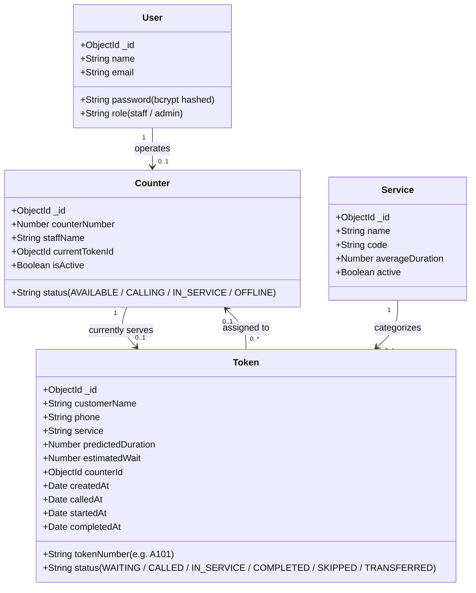

# 💻 MERN Stack & Technical Architecture Deep Dive
**Department of AI & DS | Easwari Engineering College**  
**Student:** Adithya P K (310624243009) | **Project:** QFlow

---

## 1. What is the MERN Stack and Why Was It Used?

The **MERN Stack** is a cohesive, open-source technology stack consisting of four key technologies:
- **M** — **MongoDB:** NoSQL Document Database
- **E** — **Express.js:** Minimalist Web Framework for Node.js
- **R** — **React 19:** Component-Based Reactive Frontend UI Library
- **N** — **Node.js:** Asynchronous Event-Driven JavaScript Runtime

```
 ┌────────────────────────────────────────────────────────┐
 │                      REACT 19 UI                       │
 │        Vite Bundler • Tailwind CSS • Lucide Icons      │
 └───────────────────────────┬────────────────────────────┘
                             │  HTTP REST + WebSocket (JSON)
                             ▼
 ┌────────────────────────────────────────────────────────┐
 │               EXPRESS.JS / NODE.JS SERVER              │
 │      REST API Controllers • Socket.IO Event Engine     │
 │     AI Prediction Heuristics • JWT Security Guards     │
 └───────────────────────────┬────────────────────────────┘
                             │  Mongoose ODM (BSON)
                             ▼
 ┌────────────────────────────────────────────────────────┐
 │                    MONGODB DATABASE                    │
 │       Tokens • Counters • Services • Users Collections │
 │     Atomic findOneAndUpdate • Aggregation Pipelines    │
 └────────────────────────────────────────────────────────┘
```

---

### Detailed Breakdown of Each Component

### 1. MongoDB (Database Layer)
- **Role in QFlow:** Source of truth for tokens, counters, staff accounts, and service types.
- **Why Chosen Over SQL:**
  1. **Schema Flexibility:** Tokens evolve through different lifecycle states, capturing varied metadata like `transferHistory` arrays, teller assignments, and timestamps (`calledAt`, `startedAt`, `completedAt`). In SQL, this requires multiple joins across separate tables; in MongoDB, it is stored cleanly inside a single document.
  2. **High Write Throughput:** A busy queue experiences frequent concurrent writes. MongoDB’s WiredTiger engine handles memory-mapped atomic operations efficiently.
  3. **Atomic Concurrency:** Supports `findOneAndUpdate` with condition filters, guaranteeing that two tellers clicking at once can never claim the same customer.
  4. **Zero-Config Resilient Fallback:** The codebase includes `MongoMemoryServer`, which automatically boots an in-memory database instance if local MongoDB is stopped, ensuring the project never crashes during an exam.

### 2. Express.js (Backend Application Layer)
- **Role in QFlow:** Organizes RESTful API endpoints (`/api/tokens`, `/api/counters`, `/api/auth`, `/api/analytics`), applies security middleware, and handles business logic.
- **Why Chosen:**
  1. **Fast Routing & Middleware Chaining:** Handles CORS headers, body parsing, and JWT authentication cleanly via sequential middleware pipelines.
  2. **Clean Separation of Concerns:** Controllers handle requests, services execute AI predictions, and models define database constraints.

### 3. React 19 + Vite (Frontend Presentation Layer)
- **Role in QFlow:** Powers both the Customer Mobile Portal and the Staff Operations Dashboard.
- **Why Chosen:**
  1. **Fast Rendering with Virtual DOM:** Updates UI cards and badges dynamically without whole-page browser reloads.
  2. **React Context (`useContext`):** `QueueContext` listens to Socket.IO events and updates state across all components instantaneously.
  3. **Vite Tooling:** Replaced Webpack with `esbuild`, delivering sub-second dev server boot and instant Hot Module Replacement (HMR).
  4. **Tailwind CSS:** Utility-first responsive CSS styling with dark-mode aesthetic and accessible touch targets.

### 4. Node.js (Runtime Layer)
- **Role in QFlow:** Executes server JavaScript outside the browser on the `libuv` event loop.
- **Why Chosen:**
  1. **Non-Blocking Asynchronous I/O:** Ideal for real-time WebSocket connections where thousands of clients can stay connected without spawning memory-heavy OS threads.
  2. **Universal Language:** Developers write JavaScript across both client and server, sharing data structures without conversion.

### 5. Plus: Socket.IO (The Real-Time Engine)
- **Role in QFlow:** Full-duplex WebSocket communication between the server, customer mobile devices, and staff dashboards.
- **Key Advantage:** Replaces expensive HTTP polling. When a teller clicks "Call Next", an event is pushed over an open socket in **under 50ms**, triggering on-screen alerts and native device vibration.

---

## 2. End-to-End Operational Lifecycle & Data Flow

```
[Customer Phone]                      [Express / Socket.IO]                     [MongoDB]
       │                                       │                                    │
       │─── 1. POST /api/tokens ──────────────>│                                    │
       │    (Name, Phone, Service)             │─── 2. Run AI Prediction ──────────>│
       │                                       │       (Duration & Wait Time)       │
       │                                       │─── 3. Atomic Insert Token ────────>│
       │<── 4. Return Token A101 + Wait Time ──│<── 5. Saved Document ──────────────│
       │                                       │                                    │
       │                                       │─── 6. emit 'tokenCreated' ────────> [Staff Dashboard]
       │                                       │       (Queue updates live)         │
       │                                       │                                    │
       │                                       │<── 7. PATCH /call-next ──────────── [Staff clicks Call]
       │                                       │─── 8. findOneAndUpdate(WAITING) ──>│
       │<── 9. emit 'yourTurn' (Room: A101) ───│                                    │
       │    (VIBRATES + Flashes Alert)         │                                    │
```

---

## 3. The 2 Core AI & Heuristic Algorithms

### Algorithm 1: Service Duration and Wait-Time Prediction
1. **Calibrated Baseline:** Uses 500 synthetic transaction records generated via the seeded **Mulberry32** pseudo-random generator ($seed = 42$) across 5 standard service types:
   - Account Service (Base 8 min $\pm 4$)
   - Payment Service (Base 10 min $\pm 5$)
   - Document Verification (Base 15 min $\pm 7$)
   - Customer Support (Base 7 min $\pm 3$)
   - General Enquiry (Base 5 min $\pm 2$)
2. **Weighted Regression:** Records matching the current hour receive **double weight ($w_i = 2$)**, while other hours receive single weight ($w_i = 1$).
3. **Peak Hour Adjustment:** Adds **1.5 minutes** if the current hour is during peak facility traffic (9–11 AM, 2–4 PM).
4. **Queue Buffer:** Adds $0.05\text{ min} \times Q_{ahead}$ to account for staff cognitive fatigue.
5. **Wait-Time Derivation:**
   $$T_{wait} = \max\left(0, \operatorname{round}\left(\frac{\text{Total Pending Workload}}{\text{Active Open Counters}}\right)\right)$$

---

### Algorithm 2: Dynamic Heuristic Counter Recommendation (0–100 Points)
For each active counter:
1. **Base State Score:**
   - Available Desk + No Active Token: **100 points**
   - Available Desk: **80 points**
   - Calling Customer: **50 points**
   - In-Service Desk: **30 points**
2. **Workload Penalties:**
   - Deducts **5 points** for each waiting token already routed to that desk.
   - Deducts **2 points** for each minute of predicted remaining service time.
3. **Recommendation:**
   $$C^* = \arg\max_{c \in C_{active}} S_{final}(c)$$
   Accompanied by an explainable string (e.g. *"Counter 2 recommended: desk is available with zero backlog"*).

---

## 4. Atomic Concurrency Implementation

To prevent double-assignment race conditions:
```javascript
// server/src/controllers/tokenController.js
const token = await Token.findOneAndUpdate(
  { _id: req.params.id, status: 'WAITING' },
  {
    status: 'CALLED',
    calledAt: new Date(),
    counterId: counter._id,
  },
  { new: true }
);

if (!token) {
  return res.status(409).json({
    success: false,
    message: 'Token was already called by another counter.',
  });
}
```
MongoDB guarantees that document updates are atomic. Only one thread can flip `status` from `'WAITING'` to `'CALLED'`.

---

## 5. Database Schema Architecture


